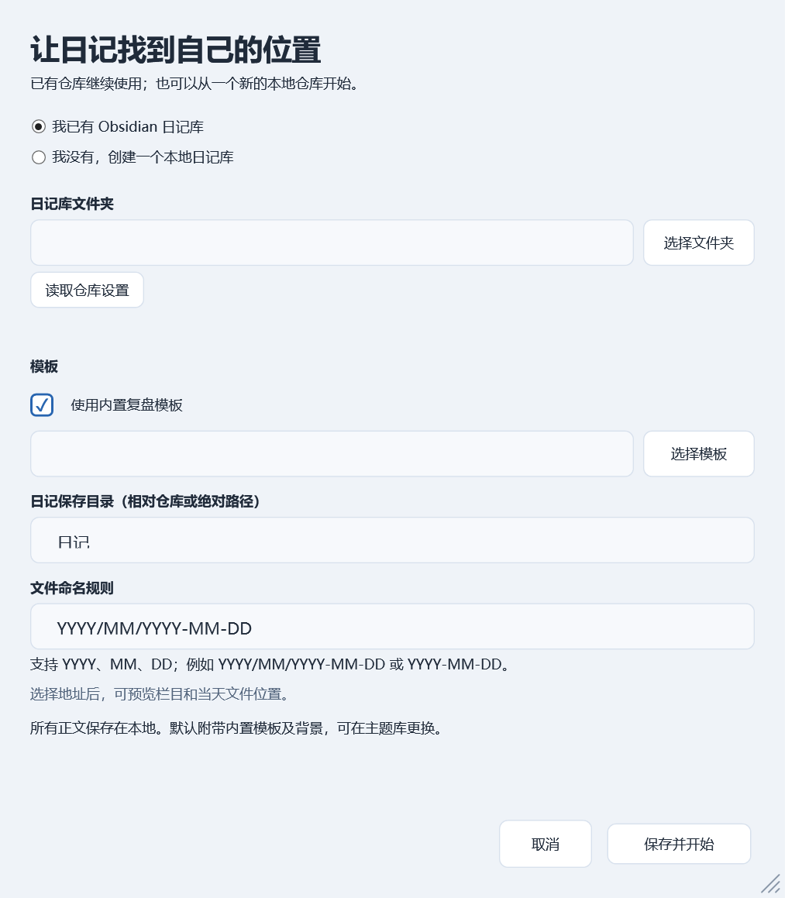
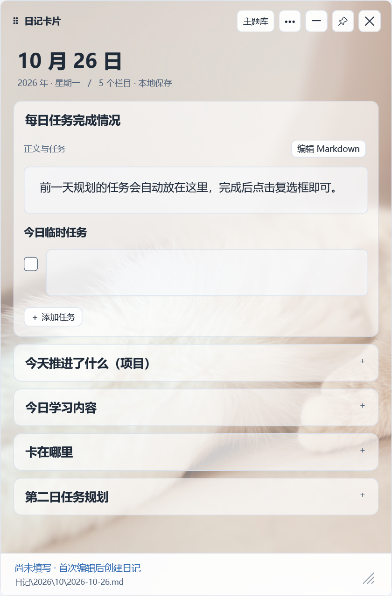

# DiaryCard · 日记卡片 V2.01

面向 Obsidian 用户的 Windows 本地桌面日记卡片。公开版本名 **V2.01**，程序产品版本 **2.0.1**。C# / WPF / .NET 10；Windows 10/11 x64 自包含发行包，无需另装 .NET。日记仅保存在本地，不需要 Obsidian 保持打开，不注册开机启动。

## 下载与首次使用

从 [V2.01 Release](https://github.com/Oliver-Yang9/DiaryCard/releases/tag/V2.01) 下载 Windows-x64.zip，完整解压到有写入权限的目录，双击“日记卡片.exe”。首次向导提供：

- **已有 Obsidian 日记库**：选择仓库根目录，点击“读取仓库设置”。优先读取 `.obsidian/daily-notes.json`，其次读取 Periodic Notes 的 daily 配置；可以调整模板、记录目录与命名。
- **没有日记库**：在程序目录下新建 `DailyNote`，附带 Obsidian 配置和默认复盘模板，日记写入 `DailyNote/日记/YYYY/MM/YYYY-MM-DD.md`。已有内容时拒绝覆盖。

取消向导不创建文件。旧版用户可将本版解压到新目录，再选择原日记库；旧笔记留在原位置。请先退出编辑同一仓库的旧卡片。不要用发行包覆盖自己的 diary-card.json 或 data。

## 日常操作

- 拖动顶部移动卡片，四边及右下角调整大小；顶部提供隐藏至托盘、置顶、保存后退出。
- 托盘单击或再次启动恢复卡片。Esc 隐藏；Ctrl+S 立即保存；Ctrl+加号／减号调整字号。
- “••• → 日记库设置…”可以修改仓库、模板、日记目录和命名规则。切换前保存当前内容，成功后自动重新打开目标库；失败保留当前输入。
- 主题库提供清透、暖纸、深色和磨砂主题，支持本地图片、GIF、静音循环 MP4，调整栏目透明度和背景显现度。
- 四边贴边自动收起，带收起／展开动画，鼠标移到边缘细条恢复。

## 模板和保存

按 Markdown 二级标题生成栏目，保持标题及顺序；三级标题归属上级栏目。支持中文、多行、列表、任务复选框及栏目 Markdown 编辑，保留 YAML 和任务区域标记。`{{date:YYYY-MM-DD}}` 创建笔记时替换为本地日期，原模板不改。

默认复盘模板含 5 个栏目，默认背景随程序嵌入；已有库优先使用自己的模板。模板修改后自动更新栏目，保留已填内容及模板外章节。内置模板仍保留原文中关于任务承接的提示，**本版没有跨天任务继承功能**。

当天文件存在就读取继续编辑；首次编辑创建当天文件；运行期间跨天先保存旧日，再创建或匹配新日。输入停顿自动保存，状态明确显示保存中、已保存或错误。外部修改尝试按章节合并，同栏冲突保留恢复草稿，避免静默覆盖。

## 配置与迁移

首次向导生成 EXE 旁 `diary-card.json`；`data/` 保存外观、背景副本、恢复草稿、备份及模板参考。新建库采用相对路径，整个目录可一并迁移。自定义外部库可使用绝对路径，`PathMappings` 可用于迁移地址映射，示例见 `diary-card.example.json`。

模板路径和日记目录相对仓库；数据路径相对程序配置。已有 Obsidian 日记目录为空表示仓库根目录，缺省命名按 YYYY-MM-DD。只支持 YYYY、MM、DD 与目录分隔，不支持完整 Moment 语法。含符号链接或重解析目录的路径会被拒绝。

## 构建与验证

安装 .NET 10 SDK，在源码根目录运行：

```powershell
.\build.ps1
.\prepare-test-media.ps1 # 可选：下载 MP4 开发测试素材
.\verify.ps1
.\setup-process-test.ps1
# ConfigPath 使用 verify 输出的隔离测试目录
.\process-test.ps1 -ConfigPath .\local\tests\verify-日期时间\ui\ui-config.json
```

build.ps1 输出 `release/V2.01/日记卡片.exe`，可用 `-DotnetPath`、`-OutputDirectory` 指定路径。首次还原需联网访问 NuGet，日常使用不需联网。`--setup-tests --test-root ...` 和 `--setup-ui-smoke --test-root ...` 验证首次使用功能。全部测试在隔离目录运行，不修改系统日期和真实日记。

## 版本与边界

[更新日志](CHANGELOG.md)。发行程序未带 Authenticode 签名，能否运行取决于设备应用控制策略。本项目不修改系统防护设置。保存失败时应保留输入并按提示恢复；物理断电、所有中文输入法、多显示器缩放组合和真实托盘鼠标命中未全面自动验证。

源码采用 MIT 许可；随附 .NET 运行组件许可见发行包 licenses。默认背景可通过主题库更换。个人笔记、配置、草稿及本机测试库不属于公开发行内容。
## 实际运行预览





截图来自隔离测试库，无个人日记。
