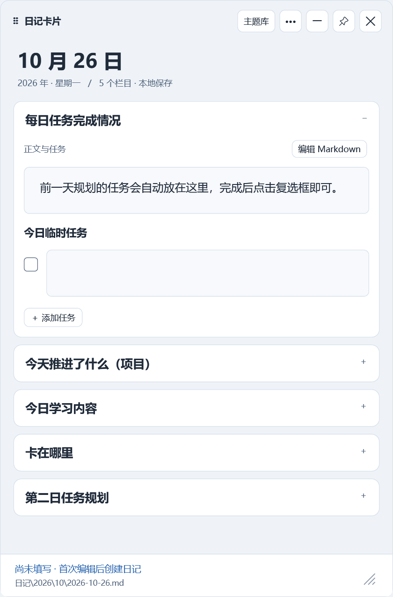
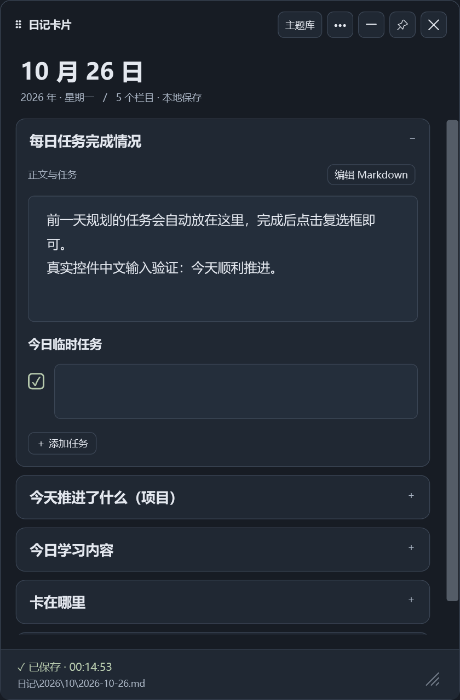

# DiaryCard · 日记卡片

一个为 Windows 桌面设计的本地日记卡片。将 Markdown 模板的二级标题变成可填写的栏目，直接保存为 Obsidian 日记，不需要 Obsidian 保持打开。

当前正式版：**1.2.0**。C# / WPF / .NET 10，Windows 10/11 x64，自包含发行包无需另装 .NET。



## 功能

- 手动启动；卡片可拖动、缩放、置顶，隐藏至托盘与保存后退出分开。
- 四边自动收起与滑入／滑出动画，鼠标移入边缘细条恢复。
- 动态解析模板中的二级标题，三级标题、中文、多行、列表和任务复选框归属原栏目。
- 模板更改后自动同步新增栏目、顺序和未修改提示；已有输入及不确定对应关系的旧章节保留。
- 自动保存当天 Markdown；启动和恢复时读取已有内容，运行期间跨天自动创建或载入当天文件。
- 保留 YAML、模板日期变量和任务区域标记，检测外部修改与同栏冲突，保留恢复草稿及上一版。
- 清透卡片、暖纸、深夜墨色、雾透玻璃四主题；深色主题覆盖设置和更多菜单。
- 本地图片、GIF 与静音循环 MP4 背景；可调栏目透明度。隐藏或贴边收起时暂停动态背景。
- 配置目录迁移映射，兼容旧路径生成的恢复草稿及模板缓存。

日记、草稿和背景均保存在本地。程序不包含遥测、上传或开机启动注册。**不内置跨天任务继承**；模板里有关承接的说明不代表程序实现了该功能。

## 下载与启动

从 [Releases](https://github.com/Oliver-Yang9/DiaryCard/releases) 下载 Windows x64 ZIP，解压到有写入权限的目录。先编辑 EXE 旁的 diary-card.json，将 VaultPath 指向自己的 Obsidian 仓库，再双击 日记卡片.exe。

发行文件未带 Authenticode 签名，是否允许运行取决于本机安全策略；本项目不修改系统防护设置。

### 配置示例

```json
{
  "VaultPath": "C:\\Notes\\Obsidian",
  "TemplatePath": "",
  "DiaryFolder": "",
  "DateFormat": "",
  "UserDataPath": "",
  "PathMappings": {}
}
```

空模板、日记目录和命名规则会读取仓库的 .obsidian/daily-notes.json；没有相应设置时默认模板为 模板/03-工作学习复盘.md，日记目录为 日记，命名为 YYYY/MM/YYYY-MM-DD.md。请根据自己的仓库显式配置或创建模板。仓库未配置且程序不在仓库内时，1.2.0 保留历史兼容默认 E:\DailyNote；建议始终设置 VaultPath。

UserDataPath 留空时使用 %LOCALAPPDATA%/DailyDiaryCard；可设置单独目录。VaultPath、UserDataPath 相对配置文件解析，TemplatePath、DiaryFolder 相对仓库解析。空 PathMappings 不启用映射。

[示例模板](review-assets/复盘模板.md) 包含 YAML、二级／三级标题和任务区域标记。创建笔记时将 {{date:YYYY-MM-DD}} 替换为本地日期，原模板保持不变。

### 操作

- 拖动顶部标题／日期移动，四周边缘或右下角手柄缩放。
- 顶部横线或 Esc：保存后隐藏；托盘单击或重复启动恢复。
- 图钉：置顶；叉号、Alt+F4、菜单退出：保存成功后结束。保存失败保留输入和窗口。
- Ctrl+S 立即保存；输入停顿约 650ms 自动保存；Ctrl+加号／减号调整字号。
- “••• → 重新读取模板”立即重试模板同步；平常通常在模板稳定且停止输入后约 2–4 秒同步。
- “编辑 Markdown”编辑完整栏目原文，“查看与恢复草稿”查看和保留冲突内容。
- 主题库选择背景与主题，栏目透明度只影响栏目底色。MP4 静音循环，GIF 支持暂停和恢复。



截图是实际运行的控件渲染，文字为合成验收内容；不包含桌面合成的窗口外阴影。

## 保存与恢复

手动首次打开只读取，首次编辑才创建不存在的当天笔记；运行期间跨天会先保存旧日，再创建或载入新日。已有文件继续编辑，不重复生成副本。原有属性、其他章节及任务标记受到保护。

外部改了不同章节或属性时尝试合并，同一栏目冲突则保留双方并暂停写入。模板删除或不确定改名的旧章节显示于“模板外已有内容”，不自动丢弃。新模板 YAML 用于之后新建的笔记，已有笔记保留原属性。

数据目录内 settings.json 保存外观，backgrounds/ 保存背景副本，recovery/ 保存草稿，backups/ 保存上一版，templates/ 保存模板版本参考。这些内容是本地明文，不应提交 Git。程序不会自动删除历史草稿。

不保证物理断电时主文件始终完整；强制终止可能丢失尚未进入恢复日志的最近输入。冲突处理前可先另存本地 Markdown 草稿。

## 路径迁移

只需要改配置时，无需修改 Obsidian 仓库或创建系统链接。例如迁移程序自己的数据目录：

```json
"PathMappings": {
  "C:\\OldDiaryCard": "D:\\DiaryCard"
}
```

按完整目录边界匹配、最具体项优先，目标相对配置文件解析，只转换一次。映射也用于查找旧路径散列命名的草稿和模板缓存。它不移动文件，不让旧 EXE 的启动路径继续有效；迁移后应更新启动入口。不要映射仍需保留原位置的仓库根目录。

## 构建

安装 [.NET 10 SDK](https://dotnet.microsoft.com/download/dotnet/10.0)，在仓库根目录使用 PowerShell：

```powershell
.\build.ps1
# 或指定 SDK、输出目录
.\build.ps1 -DotnetPath 'C:\SDK\dotnet.exe' -OutputDirectory '.\build\candidate'
```

输出在 release/。首次还原微软运行组件需要 NuGet 官方源；程序运行无需联网。脚本优先使用 local/build/dotnet/dotnet.exe，找不到则使用 PATH 中的 dotnet。审核预览可使用 build-review.ps1；它生成隔离的示例仓库。

## 验证

```powershell
# 显式下载可选的 MDN MP4 开发验收素材，不会随发行包分发
.\prepare-test-media.ps1
.\verify.ps1
# 使用上一步输出的测试目录
.\process-test.ps1 -ConfigPath '.\local\tests\verify-日期时间\ui\ui-config.json'
```

默认复制示例模板到 local/tests/ 验证，也可通过 -TemplatePath 指定自己的模板。该版本的完整验收模板约定首栏为“每日任务完成情况”、末栏为“第二日任务规划”，并含今日临时任务及任务区域标记；其他任意模板可用于程序，测试数据需满足验收夹具约定。

1.2.0 在开发者的 Windows 图形桌面环境通过 49 项文件检查、231 项界面检查和 6 项独立进程检查（界面采样检查数可能随计时变化）。包含模拟跨天、文件占用／只读失败、外部冲突、模板热更新、地址映射和实际 GIF／MP4 播放。模拟时钟不会修改系统时间。详见 [验证说明](docs/verification.md)。

## 许可证

本项目原创源码、图标和示例资源采用 [MIT License](LICENSE)。.NET 运行组件的许可证与第三方声明随发行包 licenses/ 提供。外部 MDN MP4 测试素材不在本项目 MIT 授权范围内，也未包含在仓库或发行包中。